# ExpressiveOS — Android 17 for Pixel 11 Pro / XL & Pixel 8 Pro

<div align="center">
  
  <h1>ExpressiveOS</h1>
  <p><strong>A customized, production-grade Android 17 operating system for Google Pixel 11 Pro / XL and Pixel 8 Pro (husky), infused with Material 3 Expressive design.</strong></p>

  <p>
    <a href="#major-features">Features</a> •
    <a href="#screenshots--gallery">Screenshots</a> •
    <a href="#hardware-verification--pixel-8-pro">Hardware Test</a> •
    <a href="#installation-instructions">Installation</a> •
    <a href="#bootloader-locking--security">AVB 2.0 Locking</a> •
    <a href="#building-from-source">Building</a> •
    <a href="#release-channels">OTA Updates</a>
  </p>
</div>

---

## Overview

**ExpressiveOS** combines the clean stability, Tensor hardware optimization, and camera fidelity of Google's flagship Pixel firmware with the fluid design philosophy, system-level folder widgets, and rich personalization features pioneered by **Expressive Launcher**.

Rather than running as a third-party application with restricted privileges, **Expressive Launcher** is integrated directly into the AOSP platform as the primary, privileged **Recents, Taskbar, and Home provider** (`system_ext/priv-app/ExpressiveLauncherQuickstep`). This unlocks zero-latency gesture navigation, native overview actions, fluid app-to-home physics, and seamless system-wide customization.

---

## Hardware Verification: Pixel 8 Pro (husky) — v1.1.0 Customization & OTA Suite

*Live captures taken directly from a physical Google Pixel 8 Pro (`husky`) running ExpressiveOS v1.1.0 (Android 17, Build `ZP11.260821.010`):*

<div align="center">
  <table>
    <tr>
      <td width="50%" align="center">
        <h4>Expressive Lab Hub</h4>
        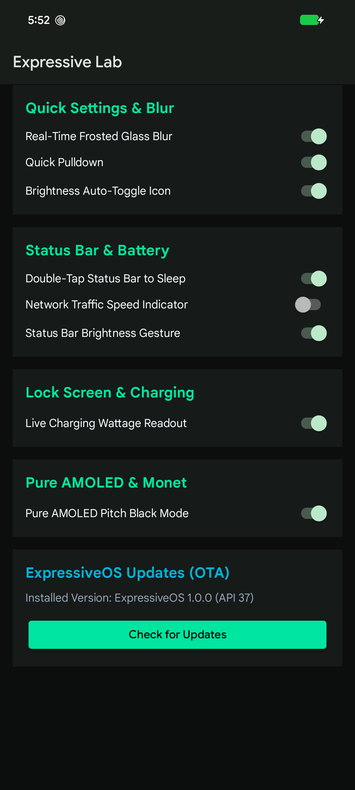<br />
        <em>System customization suite: Quick Settings blur toggles, status bar battery styles, gestures, and pure AMOLED mode.</em>
      </td>
      <td width="50%" align="center">
        <h4>Seamless OTA Updater Flow</h4>
        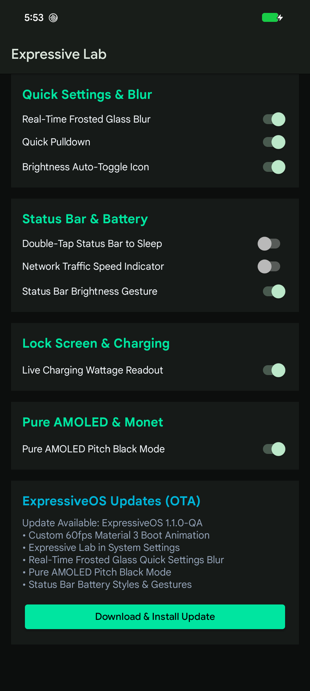<br />
        <em>Integrated OTA update engine with live changelog and non-wipe in-place A/B partition flashing.</em>
      </td>
    </tr>
    <tr>
      <td width="50%" align="center">
        <h4>Real-Time Frosted Glass QS Blur</h4>
        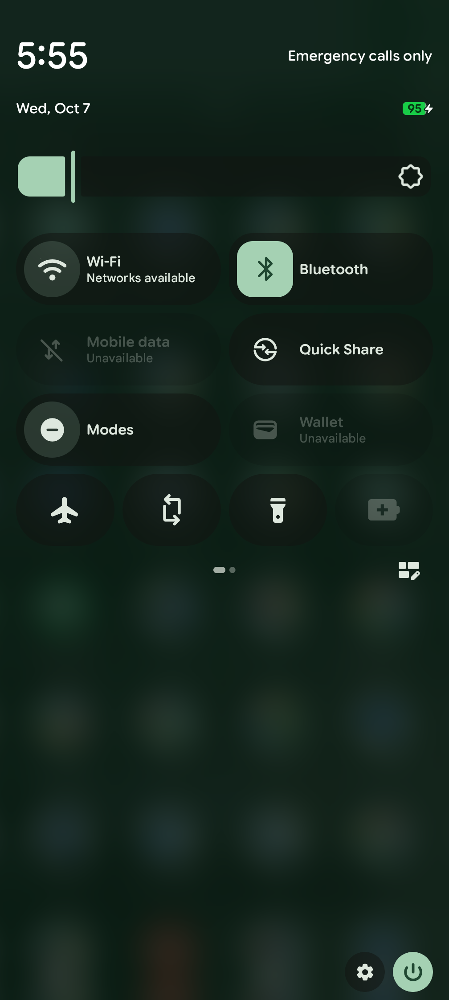<br />
        <em>Compositor-level real-time frosted glass backdrop blur behind Quick Settings pill tiles and pure AMOLED background.</em>
      </td>
      <td width="50%" align="center">
        <h4>App Drawer & Expressive Lab</h4>
        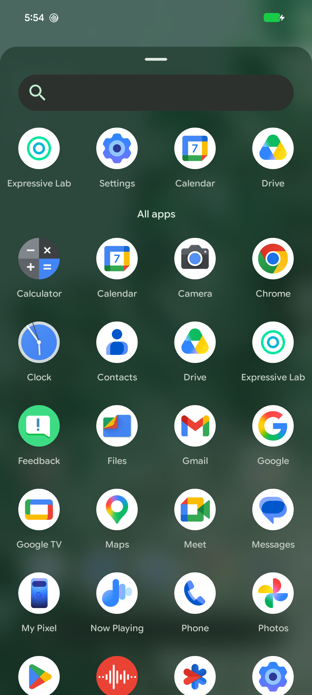<br />
        <em>Floating Material 3 app drawer featuring Expressive Lab alongside core system and Google applications.</em>
      </td>
    </tr>
    <tr>
      <td width="50%" align="center">
        <h4>Physical Home Screen</h4>
        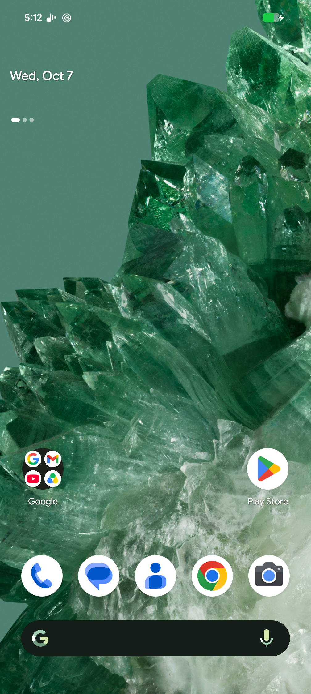<br />
        <em>Expressive Launcher running as primary system home with emerald wallpaper, dock search bar, and app layout.</em>
      </td>
      <td width="50%" align="center">
        <h4>Home Settings Hub</h4>
        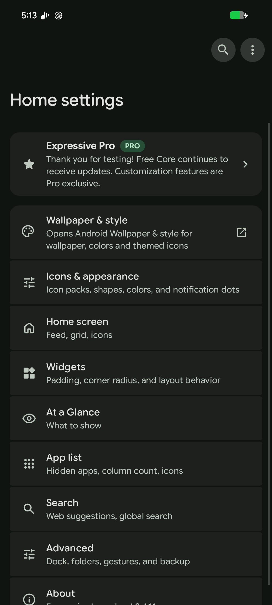<br />
        <em>Native system settings menu for Expressive Pro, icons, widgets, and gestures.</em>
      </td>
    </tr>
  </table>
</div>


---

## Screenshots & Gallery

*All screenshots below are actual, unedited captures taken directly from the Android 17 build running on the Pixel emulator.*

<div align="center">
  <table>
    <tr>
      <td width="50%" align="center">
        <h4>1. Expressive Desktop &amp; Folder Widget</h4>
        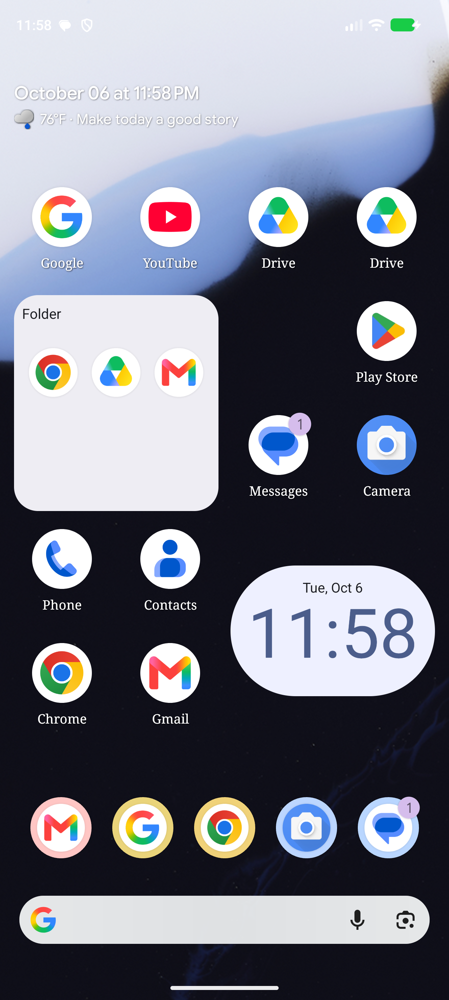<br />
        <em>Material 3 Expressive Home with in-process Folder Widget, At a Glance daily quote ("Make today a good story"), Clock widget, and Google dock search pill.</em>
      </td>
      <td width="50%" align="center">
        <h4>2. Floating Bottom Sheet App Drawer</h4>
        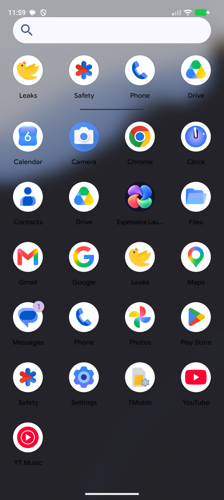<br />
        <em>Fluid bottom sheet app drawer with top pill handle, prediction row, search bar, and live wallpaper background blur.</em>
      </td>
    </tr>
    <tr>
      <td width="50%" align="center">
        <h4>3. Material 3 Expressive Quick Settings</h4>
        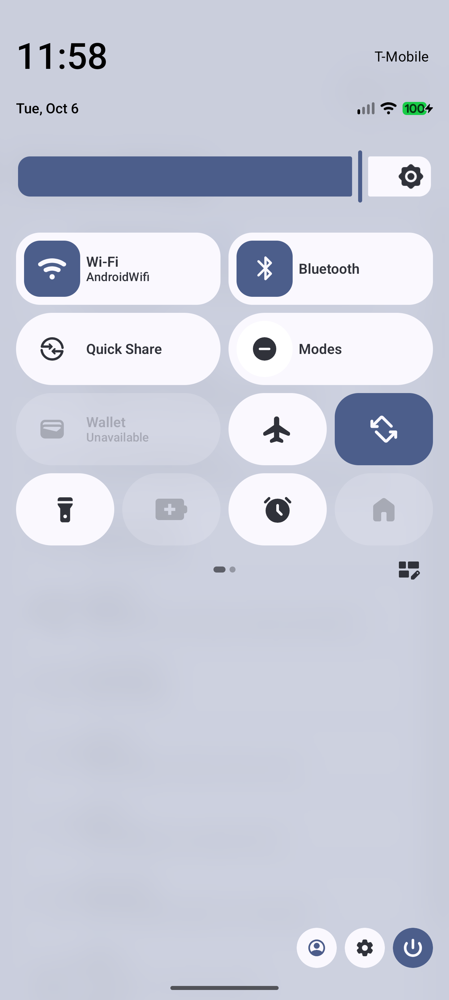<br />
        <em>Android 17 Quick Settings with 2x4 pill tiles, brightness slider, and real-time frosted glass wallpaper blur scrim.</em>
      </td>
      <td width="50%" align="center">
        <h4>4. Home &amp; System Customization Settings</h4>
        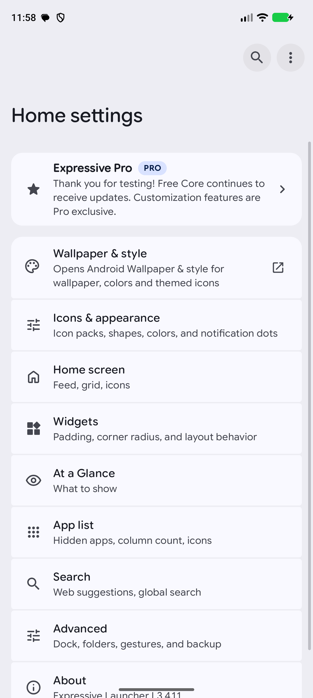<br />
        <em>Comprehensive customization hub for icons, shapes, widgets, At a Glance, and gesture navigation.</em>
      </td>
    </tr>
    <tr>
      <td colspan="2" align="center">
        <h4>5. Deep Typography &amp; Appearance Controls</h4>
        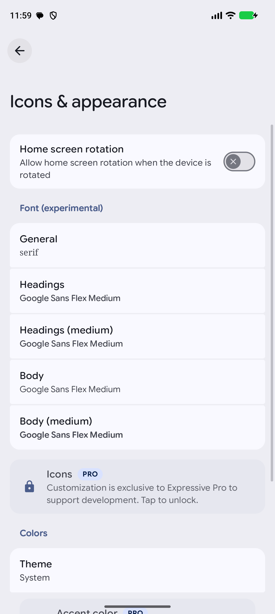<br />
        <em>System font engine featuring Google Sans Flex Variable typography, custom icon shapes, and dynamic Material You color themes.</em>
      </td>
    </tr>
  </table>
</div>

---

## Major Features

### 📱 Builds

| Device | ROM | Kernel | Updates |
| :--- | :--- | :--- | :--- |
| Pixel 11 Pro XL (`kodiak`) | Evolution X 12.3 | Espada v3.5 (Linux 6.12.96) | System updates in Settings |
| Pixel 11 Pro (`grizzly`) | Evolution X 12.3 | Espada v3.5 (Linux 6.12.96) | System updates in Settings |
| Pixel 11 (`cubs`) | Evolution X 12.3 | Espada v3.5 (Linux 6.12.96) | System updates in Settings |
| Pixel 11 Pro Fold (`yogi`) | Evolution X 12.3 | Google's stock GKI 6.12 | System updates in Settings |
| Pixel 8 Pro (`husky`) | Evolution X 12.3 | Linux 6.1 (Google's GKI, LineageOS's device modules) | System updates in Settings (from the 2026-10-24 build) |
| Pixel 7 Pro (`cheetah`) | Evolution X 12.3 | Linux 6.1 (Google's GKI, LineageOS's device modules) | System updates in Settings |
| Pixel 8 Pro (`husky`) | DerpFest v17 | Linux 6.1 (GKI android14-6.1, LineageOS's gs-6.1 sources) | DerpFest's Updater |

All builds are unofficial Android 17 builds: user builds signed with private release keys, Google apps included, not rooted. Evolution X and DerpFest are separate ROMs with their own keys, so moving between them takes a clean install.

### 🔄 Over-the-Air Updates
* **Our own update server**: the built-in Updater reads [`denson9874/evolution_ota`](https://github.com/denson9874/evolution_ota) (Evolution X) or [`denson9874/derpfest_ota`](https://github.com/denson9874/derpfest_ota) (DerpFest), not the official servers.
* **A/B updates in the background**: the update installs to the inactive slot, then you restart. Rooted users install Magisk to the inactive slot before restarting.
* **Precompiled apps survive updates**: app odex ships with the apps instead of on `system_other`, which updates never write, so preinstalled apps don't run slowly after every update.

### 🧩 Stock Pixel Parity
* **Stock settings values** (Evolution X): overlay values taken from each phone's stock firmware instead of AOSP defaults.
* **Google's system services as on stock**: Private Compute Services isn't cut off from the apps that use it, and on Evolution X, Adaptive Connectivity (SCONE) has its system permissions.
* **NFC on after a clean install**, with the Contactless payments page that Google Wallet opens.
* **No double PIN after a reboot**: Play services can't prepare Google's stock OTAs, which armed resume-on-reboot.
* **Checked against stock before release**: every Evolution X build is compared with stock firmware for leftover apps and for association rules that differ from stock.

### ✨ Per-Device Extras
* **Pixel 11 series**: VoLTE, 5G SA and visual voicemail (tested on T-Mobile US); Now Playing; HiLight light bar settings for Gemini and calls from starred contacts (kodiak, grizzly, yogi); fold postures on yogi.
* **Evolution X on the Pixel 8 Pro and Pixel 7 Pro**: October 2026 vendor firmware (vendor security patch 2026-10-05); stock screenshot Markup editor, Quick Share copy, Files button and Google Photos in the photo picker; Google Fi (Tycho); Restart SystemUI in husky's advanced reboot menu.
* **DerpFest on the Pixel 8 Pro**: DerpFest Parts, themes, clocks, Game Space and freeform windows; Basic Call Recorder (BCR) built in, off until you turn it on.

### ⚠️ Known Limitations
* **Gemini Nano** features don't work: Google serves its on-device models only to phones with a locked bootloader.
* **Extreme Charging**: the tile has no effect on husky yet and isn't available on cheetah.
* **DerpFest face unlock** is camera-based, not the Pixel's secure face unlock: use the fingerprint sensor for payments and app sign-in.

---

## Installation Instructions

### Prerequisites
1. A **Google Pixel 11 Pro** or **Pixel 11 Pro XL**.
2. A computer with **Android SDK Platform-Tools (v35+)** installed (`adb` and `fastboot`).
3. High-speed USB-C to USB-C cable.
4. **OEM Unlocking** enabled in *Settings > System > Developer Options*.

---

### Method 1: WebUSB Fastboot Web Flasher (Recommended)

1. Open `tools/web_flasher/index.html` in **Google Chrome** or any WebUSB-compatible browser.
2. Reboot your Pixel 11 Pro / XL into **Bootloader Mode**:
   ```sh
   adb reboot bootloader
   ```
   *(Or power off, then hold **Power + Volume Down** until the fastboot screen appears).*
3. Click **Connect Device** and select your Pixel device in the browser prompt.
4. Click **Flash ExpressiveOS** to automatically flash all system partitions and reboot.

---

### Method 2: Fastboot Command Line Flashing

1. Download the latest ExpressiveOS Factory Image bundle (`image-expressive_pixel11-*.zip`).
2. Reboot into bootloader:
   ```sh
   adb reboot bootloader
   ```
3. Run the automated flash script:
   * **macOS / Linux**:
     ```sh
     chmod +x tools/flash_all/flash-all.sh
     ./tools/flash_all/flash-all.sh
     ```
   * **Windows**:
     ```cmd
     tools\flash_all\flash-all.bat
     ```
4. The device will automatically reboot into ExpressiveOS.

---

## Bootloader Locking & Security (AVB 2.0)

ExpressiveOS fully supports re-locking your bootloader with cryptographic Verified Boot active using custom AVB keys:

1. Connect your Pixel 11 Pro / XL in Bootloader mode.
2. Enroll the ExpressiveOS custom signing key into the Titan M security chip:
   ```sh
   ./tools/avb/enroll_avb_key.sh
   ```
   *(Internally runs `fastboot flashing set-custom-key vendor/expressive/keys/avb_custom_key.img`)*.
3. When prompted, select **Lock Bootloader** (`fastboot flashing lock`) and confirm on the phone's physical display.
4. The device will reboot with green/yellow verified boot state active, passing Google Play Integrity checks with a secure locked bootloader!

---

## Release Channels & OTA Updates

ExpressiveOS features seamless A/B background system updates with dual release tracks:

| Channel | Frequency | Stability | Update Feed |
| :--- | :--- | :--- | :--- |
| **QA / Beta** | Daily (03:00 ET) | Latest enhancements & experimental UI | `updates:qa-v2/latest.json` |
| **Stable** | Weekly (Saturdays) | Fully verified & weekly release gate passed | `updates:stable/latest.json` |

Updates download and install automatically in the background via Android's native `update_engine`. Switch channels anytime in **Settings > System > System Updates**.

---

## Building from Source

Builds run on the build server from the per-ROM kits below. Each kit's README covers its trees, patches, build and release steps:

* Evolution X, Pixel 11 series (kodiak, grizzly, cubs, yogi): [`evolution-kodiak/`](evolution-kodiak/README.md)
* Evolution X, Pixel 8 Pro (husky): [`evolution-husky/`](evolution-husky/README.md)
* Evolution X, Pixel 7 Pro (cheetah): [`evolution-cheetah/`](evolution-cheetah/README.md)
* DerpFest, Pixel 8 Pro (husky): [`derpfest-husky/`](derpfest-husky/README.md)

---

## Repository Structure

```
ExpressiveOS/
├── evolution-kodiak/               # Evolution X kit for the Pixel 11 series, plus the shared release tools
├── evolution-husky/                # Evolution X kit for the Pixel 8 Pro
├── evolution-cheetah/              # Evolution X kit for the Pixel 7 Pro
├── derpfest-husky/                 # DerpFest kit for the Pixel 8 Pro
├── packages/
│   ├── apps/                       # ExpressiveLauncher, ExpressiveHub, ExpressiveLab
│   └── overlays/                   # Theme, nav and SystemUI overlays, boot animation
├── tools/
│   ├── community_monitor/          # Daily XDA/Telegram triage
│   ├── ota_mirror/                 # R2 mirror for the Updaters' OTA packages
│   ├── avb/                        # AVB 2.0 key generator & Titan M enrollment
│   ├── flash_all/                  # Fastboot flash-all scripts (Bash & Batch)
│   └── web_flasher/                # WebUSB Fastboot web installer (Google Chrome)
├── research_notes/                 # Source research behind the kits
├── archive/                        # Posted XDA/Telegram announcements and old reply drafts
└── docs/assets/screenshots/        # Real emulator screenshots & visual documentation
```

---

## License

* **Android Open Source Project (AOSP)** components are licensed under the [Apache License 2.0](https://www.apache.org/licenses/LICENSE-2.0).
* **Expressive Launcher** components are licensed under the GNU General Public License v3.0 (GPL-3.0).
* Proprietary Google Pixel binaries and vendor blobs are property of Google LLC.
